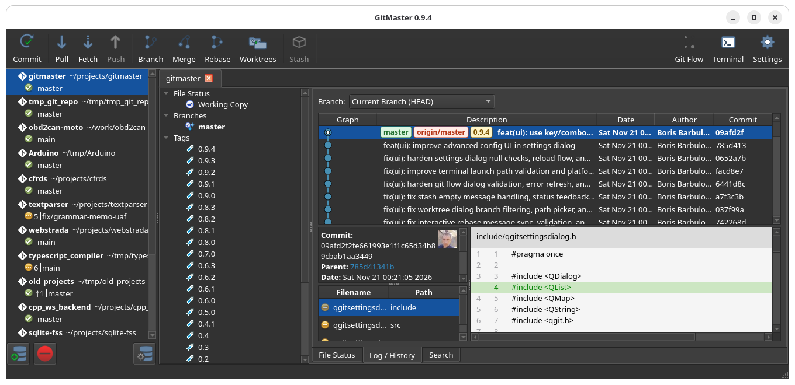

# GitMaster 🖥️

[](https://en.cppreference.com/w/cpp/20)
[](https://qt.io)
[](https://libgit2.org)
[](https://www.gnu.org/licenses/lgpl-3.0)

A lightning-fast, native **Desktop Git GUI client** designed for developers who value performance and minimalism. 

Unlike heavy, memory-hungry Electron-based Git clients, `GitMaster` is built from the ground up using **C++20**, **Qt6** for a fluid native user interface, and **libgit2** for raw, asynchronous Git operations. It offers a lightweight footprint with zero compromise on power.

---

## ✨ Features

- **⚡ Blazing Fast Performance:** Native C++ core delivers instant repository loading and smooth history scrolling.
- **🌳 Visual Git Graph:** Interactive, beautifully rendered branch topologies to track commits, merges, and tags.
- **📁 Multi-Repository Management:** Easily switch, track, and manage multiple local projects from a single workspace with live status and ahead/behind push/pull indicators.
- **🔄 Seamless Remote Sync:** Effortless `Fetch`, `Pull`, and `Push` operations with GitHub, GitLab, Gitee, and custom remotes.
- **🌿 Advanced Branching & History:** Visual shortcuts to checkout, create (with commit picker), rename, delete, merge, interactive rebase, Git Flow, worktrees, submodules, and stashes.
- **🔍 Diff Viewer & Commit Search:** Unified and side-by-side diffs with inline character/word highlighting, plus fast commit search by message, files, or author.

---

## 🛠️ Building from Source

### Prerequisites

To build GitMaster, ensure you have a modern C++ compiler (supporting C++20), **CMake**, and the required libraries installed:

*   **Linux (Ubuntu/Debian):**
    ```bash
    sudo apt-get install build-essential cmake qt6-base-dev qt6-svg-dev libgit2-dev zlib1g-dev
    ```
*   **macOS (Homebrew):**
    ```bash
    brew install cmake qt6 libgit2
    ```

### Build Steps

1. **Clone the repository:**
   ```bash
   git clone https://github.com/bokic/gitmaster.git
   cd gitmaster
   ```

2. **Configure and build using CMake:**
   ```bash
   mkdir build && cd build
   cmake -DCMAKE_BUILD_TYPE=Release ..
   make -j$(nproc)
   ```

3. **Install onto your system:**
   ```bash
   sudo make install
   ```

---

## 📸 Screenshots



## 🤝 Contributing

Contributions make the open-source community an amazing place to learn, inspire, and create. Any contributions you make are **greatly appreciated**.

1. **Fork** the Project.
2. **Create** your Feature Branch (`git checkout -b feature/AmazingFeature`).
3. **Commit** your Changes (`git commit -m 'Add some AmazingFeature'`).
4. **Push** to the Branch (`git push origin feature/AmazingFeature`).
5. **Open a Pull Request**.

---

## 📄 License

This project is licensed under the **GNU Lesser General Public License v3.0 (LGPL-3.0)** - see the [LICENSE](LICENSE) file for details.

Developed with ❤️ by [Boris Barbulovski (bokic)](https://github.com/bokic).
